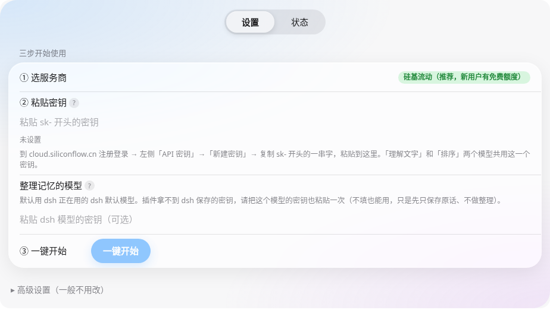
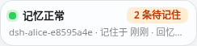
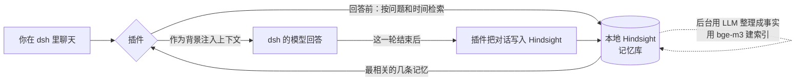
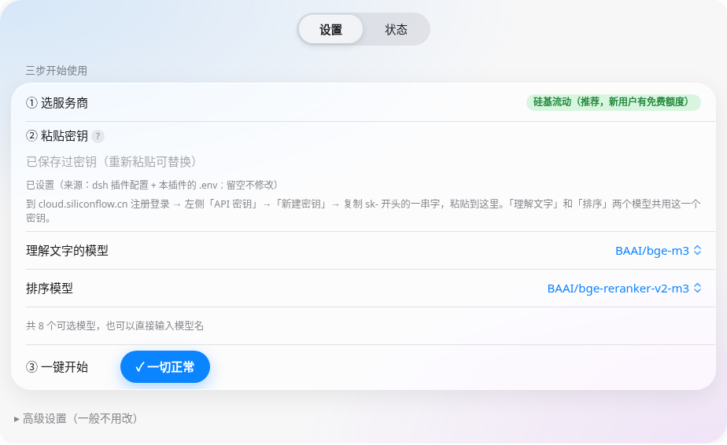

<div align="center">


# 🧠 dsh-hindsight-memory

**让 DeepSeek Harness（dsh）里的 AI 记住你们聊过的事：换个对话、隔几天再问，它都还记得。**

[](https://github.com/snakejohn/dsh-hindsight-local/stargazers)
[](https://github.com/snakejohn/dsh-hindsight-local/releases/latest)
[](https://github.com/snakejohn/dsh-hindsight-local/releases)
[](LICENSE)
[](https://github.com/snakejohn/dsh-hindsight-local/commits/dev)
[](https://github.com/snakejohn/dsh-hindsight-local/issues)
[](https://github.com/snakejohn/dsh-hindsight-local/network/members)

📖 [小白使用文档](docs/使用文档.md) · 🛠 [技术说明](docs/技术说明.md) · 📊 [压测数据](docs/bench/) · ⬇️ [下载最新版](https://github.com/snakejohn/dsh-hindsight-local/releases/latest)

**如果这个插件对你有帮助，请点右上角的 ⭐ Star 支持一下！**

</div>

<p align="center">
  
  &nbsp;
  
</p>

---

## ✨ 它能做什么

| 功能 | 用大白话说 |
|---|---|
| 🧠 **长期记忆** | 聊过的内容存在你电脑上的记忆库里，关掉 dsh、重开对话都还在。 |
| ⏰ **听得懂时间** | 每条记忆都带着本地时间，问「我早上 7 点干了啥」「昨晚吃的什么」能对上时间段。东八区凌晨到早上 8 点的记忆也已专门修正。 |
| ✍️ **自动记，也能补录** | 每轮对话会自动写进记忆库；第一次启用时，还会把以前的对话补录进去（已归档的对话除外）。 |
| 🗂 **记忆库怎么分** | 默认每个工作区一个记忆库，互不串台；也可以按角色预设分、按单个对话分，或者让所有工作区共用一个记忆库。 |
| 🙈 **归档的对话不记** | 在 dsh 里归档的对话不会被记住。 |
| 🚀 **一键本地部署** | 不用打开命令行。没有 Python 也行：插件会自动准备 uv 和 Python 3.12，再装好 Hindsight（默认走国内镜像）。 |
| 🟢 **状态卡片 + 控制面板** | 左下角的小卡片一眼看出记忆是否正常；点开就是控制面板，能看各记忆库的数量，还能浏览、搜索记忆。 |
| 👆 **「现在就记住」按钮** | 想马上把某个工作区（或全部对话）记下来，点一下就行，已经记过的不会重复记。 |
| 🛡 **绝不卡住聊天** | 记忆服务出问题、超时或被限流时，只是暂时「不带记忆」，聊天照常进行。 |

## 🔍 工作原理



1. **写入**：每轮对话结束后，插件把这一轮（带本地时间）交给本机的 Hindsight。Hindsight 在后台用 LLM 把对话整理成一条条事实，并用 embedding 建立索引。
2. **召回**：你下次提问时，插件先去记忆库里搜相关记忆（问题里有「早上 7 点」这类时间时会优先匹配该时间段），再用 reranker 排序，取最相关的几条作为背景放进上下文。
3. **省上下文**：只注入少量相关记忆，不用把整段历史都塞进去。

## 🧰 准备工作

- **dsh**：一个带插件管理器（左侧「Plugins」→「+ Add plugin」）的 DeepSeek Harness。
- **硅基流动密钥**：去 <https://cloud.siliconflow.cn> 注册，新用户有免费额度。在「API 密钥 → 新建密钥」复制 `sk-` 开头的那串字符。步骤截图见 [使用文档](docs/使用文档.md)。
- **系统**：Linux 已完整实测；Windows / macOS 的代码路径已写好，但**还没有真机验证**。
- **内存**：本地服务在 Linux 上实测约占 540 MB。

## 📦 安装（两种方式选一种）

在 dsh 左侧点「**Plugins**」→ 右上角「**+ Add plugin**」：

**方式 A：从 GitHub 安装（推荐）**：把下面这行粘进去，点「Install」

```
https://github.com/snakejohn/dsh-hindsight-local
```

**方式 B：下载 zip，从本地文件夹安装**（连不上 GitHub 时用）：先到 [Releases](https://github.com/snakejohn/dsh-hindsight-local/releases/latest) 下载 zip 并解压，再把解压后文件夹的**完整路径**填进去，点「Install」。

装好后，在「Installed plugins」里能看到 **dsh-hindsight-memory**，确认开关是打开的。

## 🚀 三步快速上手

1. **选一下**：首次设置时选「**还没有 Hindsight**」（插件帮你在本机部署）；如果你已经自己跑着 Hindsight，就选「**已经配置好了**」，填上地址即可。
2. **填密钥**：把硅基流动的密钥粘到「② 粘贴密钥」。面板会自动检查（新装时显示「未设置」，密钥永不明文显示），显示「密钥可以用 ✓」后会自动获取模型，「理解文字」「排序」两个模型用默认即可，点「**一键开始**」。所有下拉都是可搜索的玻璃选择器；Windows 上遇到 `Invalid port` 报错见使用文档的「代理」设置。第一次准备大约需要 3–10 分钟。
3. **看到「记忆正常」**：左下角的卡片变成 🟢「记忆正常」就好了。之后照常聊天，它会自己记、自己想起来。
4. **（可选）导入以前的对话**：装好后只自动记新聊天。设置页会问「**要导入以前的对话吗？**」，点「去选择」可以选一个工作区或单个对话导入，会一段一段慢慢整理，不会重复。

<p align="center"></p>

## 🤖 默认用到的模型

| 用途 | 默认 | 说明 |
|---|---|---|
| 整理记忆（LLM） | **跟随 dsh 的默认模型** | 也可以改成自定义，例如硅基流动的 `XingChenAGI/Xing4.0-29B`（预设），或 DeepSeek（`https://api.deepseek.com`）；选「不整理」时只保存原话。 |
| 理解文字（Embedding） | `BAAI/bge-m3`（硅基流动） | 1024 维 |
| 排序（Reranker） | `BAAI/bge-reranker-v2-m3`（硅基流动） | 留空时退回到纯排名融合（rrf），不调用模型 |

- 三者都能在「**高级设置**」里分别换服务商和模型；选好服务商后地址会自动填上，还能点「获取模型」拉取模型列表。
- 一个硅基流动密钥可以同时用于三者：同一个服务商的密钥只要填一次。
- **被限流时不会丢内容**：卡片会显示「模型被限流」，要记的内容先排队，稍后自动重试。

## ⚙️ 常用设置

面板里的设置保存在 dsh 的插件配置中；本地 Hindsight 用到的变量会同步写进**插件根目录的 `.env`**（只存在你电脑上，你手改过的值也会保留）。

| 设置（面板 / 配置名） | 默认 | 作用 |
|---|---|---|
| 记忆库范围 `bank.scope` | `workspace` | `workspace` = 每个工作区一个；`preset` = 每个角色预设一个；`session` = 每个对话一个 |
| 共享记忆库 `bank.default_bank` | 空 | 填上名字后，所有工作区都写进这一个记忆库 |
| 聊天时自动回忆 `recall.enabled` | 开 | 关掉就不注入记忆 |
| 每次最多回忆几条 `recall.top_n` | 6 | 注入上下文的记忆条数上限 |
| 注入字数上限 `recall.max_chars` | 4000 | 记忆块的字符上限 |
| 自动记住对话 `retain.enabled` | 开 | 关掉就不写入 |
| 启动时补录旧对话 `backfill.enabled` | 开 | 把以前的对话也记住（不含已归档） |
| 时区 `time.timezone` | 跟随系统 | 用于记忆时间和「早上 7 点」这类解析 |
| 向量维度 `embedding.expected_dim` | 1024 | 理解文字的模型输出多少个数字（bge-m3 = 1024）。换模型或迁移时必须和原来一致，不一致时插件会拦下并用中文提示，不会写坏已有记忆 |
| 端口 `service.local.port` | 8888 | 本地 Hindsight 监听的端口 |
| LLM 超时 `service.local.llm_timeout` | 300 秒 | 慢模型也能整理完 |
| 写入分块 `service.local.retain_chunk_size` | 1500 字符 | 长消息切小块处理，避免卡在「处理中」 |
| 单次最大输出 `service.local.retain_max_completion_tokens` | 8000 | 必须大于分块大小（不满足时会自动修正） |

更多配置项和环境变量（`DSH_HINDSIGHT_*`）见 [技术说明](docs/技术说明.md)。

## 📊 性能实测（v0.1.1）

用公开数据集 [LoCoMo](https://github.com/snap-research/locomo) 做的真实压测。整理记忆用的模型是 DeepSeek V4.1 Flash（`deepseek-flash`），Embedding 和 Reranker 用硅基流动的免费模型。

| 指标 | 结果 |
|---|---|
| 写入规模 | 992 轮对话 · 3 个记忆库 · 48 次写入，**全部成功**，0 次限流 |
| 花费 | 约 **¥2.37**（按 DeepSeek 账户余额前后差计算） |
| 召回命中率 | 50 题中 **94%**；其中时间类问题 **97.2%** |
| 上下文节省 | 和把整段历史塞进上下文相比，约省 **85%**（按字符估算） |
| 召回延迟 P95 | **3.3–4.9 秒**（记忆量 172–341 条） |
| 长消息 | 约 1.2 万 token 的长消息 7.6 秒写完，不再卡住 |

> LoCoMo 数据的许可是 **CC BY-NC 4.0**，这里只用于评测。原始数据见 [docs/bench](docs/bench/)。

## ❓ 常见问题

<details><summary><b>服务启动失败怎么办？</b></summary>

面板会用大白话写明「发生了什么、怎么做」，大多数情况点「重试」就行。还不行的话，在状态页点「检查一下」「重新启动」或「重新安装」。需要求助时，在状态页点「导出日志」，把生成的文件发给帮你的人（密钥会自动隐藏）。
</details>

<details><summary><b>提示端口 8888 被占用？</b></summary>

说明有别的程序占用了 8888。可以在高级设置里改端口，或者关掉占用这个端口的程序（Windows 可以用 `netstat -ano | findstr :8888` 查是哪个程序）。
</details>

<details><summary><b>卡片显示「模型被限流」或「N 段没整理好」？</b></summary>

免费模型和中转程序有频率限制。v0.1.3 起默认一次只整理 1 段（「高级设置 → 同时处理数」），失败的会自动重试，也可以在状态页点「重试失败项」，不会产生重复记忆。经常失败的话，把「整理记忆的模型」改成「自定义 → 硅基流动」，用同一个密钥即可。
</details>

<details><summary><b>卡片显示「模型地址连不上」？</b></summary>

整理记忆用的本机模型地址（例如 `127.0.0.1:3425`）没有响应，请确认对应的程序已启动。插件这期间暂停写入，连上后自动继续，并重新整理之前失败的部分。
</details>

<details><summary><b>怎么反馈问题？</b></summary>

插件「状态」页最下面点「导出日志」（密钥会自动隐藏），再点「去提问题」，把导出的文件拖进 GitHub 问题表单即可。日志会自动清理（单个 5 MB、保留 14 天），不会越积越大。
</details>

<details><summary><b>写入一直卡在「处理中」？</b></summary>

v0.1.1 默认把长消息切成 1500 字符一块处理，并把超时放宽到 300 秒，实测已经不再卡住。如果还卡住，看一下控制面板的「没记住的」区域和 `hindsight.log`。
</details>

<details><summary><b>数据存在哪里？</b></summary>

都在你自己的电脑上：

| 内容 | 位置 |
|---|---|
| 记忆数据库 | Hindsight 自带的嵌入式数据库（pg0，名为 `dsh-hindsight`），Linux 上在 `~/.pg0` |
| Python 环境 | `~/.dsh-hindsight/venv` |
| 日志 | `~/.dsh-hindsight/logs/` |
| 写入进度 | `~/.dsh-hindsight/state` |
| 服务配置（含密钥） | 插件根目录的 `.env` |
</details>

<details><summary><b>怎么备份记忆、换电脑，或把本地服务改成独立服务？</b></summary>

见使用文档的 [迁移和备份记忆](docs/使用文档.md#迁移和备份记忆) 一章：记忆存在哪里、怎么备份和恢复、怎么把插件自己的本地服务改成一直开着的独立服务、怎么合并或拆分记忆库。每一步都实测过，没实测的地方都标出来了。
</details>

<details><summary><b>我已经有一个 Hindsight 服务了，能直接用吗？</b></summary>

能。设置里选「已经配置好了」，填地址（和密码，如果服务开了的话）。插件只连接它，**不会**启动、停止或修改它；服务中途停了，聊天照常，漏记的对话会在服务恢复后自动补上。
</details>

<details><summary><b>怎么卸载？</b></summary>

1. 在 dsh 的「Plugins」里关掉或移除 **dsh-hindsight-memory**。然后重启 dsh，插件启动的本地服务会随之停止。
2. 想把数据也清掉，就删除 `~/.dsh-hindsight` 文件夹和插件目录。
3. 记忆数据库在 `~/.pg0` 里；如果电脑上没有别的程序在用 pg0，也可以一并删除。
</details>

## 🔄 更新

插件**不会自动检查新版本**，需要手动升级：

- **从 GitHub 装的**：在 dsh 插件管理器里移除后重新安装同一个地址，或者在插件目录执行 `git pull`，然后重启 dsh。
- **从 zip 装的**：到 [Releases](https://github.com/snakejohn/dsh-hindsight-local/releases/latest) 下载新版 zip，覆盖解压到原来的文件夹（保留里面的 `.env`），然后重启 dsh。

记忆数据和 `~/.dsh-hindsight` 里的内容不受升级影响。更新内容见 [更新日志](CHANGELOG.md)。

## 🔒 隐私说明

- **会发给第三方的**：用来整理记忆的对话文本，会发给你选的 LLM 服务商（默认就是 dsh 正在用的模型）；用来建索引和排序的文本，会发给 embedding 和 reranker 服务商（默认是硅基流动）。
- **只留在本机的**：记忆数据库、日志，以及密钥（只存在插件根目录的 `.env` 和 dsh 自己的配置里）。插件不会把密钥写进日志，也不会上传到别处。
- **不想记的对话**：在 dsh 里归档，它就不会被记住。

## 📚 更多文档

- [小白使用文档（带截图）](docs/使用文档.md)
- [技术说明](docs/技术说明.md)：目录结构、Hook、配置 Schema、降级规则
- [压测原始数据](docs/bench/)
- [更新日志](CHANGELOG.md)

## 🤝 参与贡献

欢迎提 [Issue](https://github.com/snakejohn/dsh-hindsight-local/issues) 和 Pull Request。提交前请先跑一遍测试：

```bash
npm test
```

## 📄 许可证

[MIT](LICENSE)

## ⭐ Star History

[](https://star-history.com/#snakejohn/dsh-hindsight-local&Date)
