# dsh 长期记忆插件 使用文档（小白版）

> 一句话：装上这个插件，dsh 里的 AI 就能**记住你们聊过的事**，下次聊天会自动想起来。
> 全程不用打开命令行，跟着图一步步点就行。

---

## 第一步：打开你的 dsh

我用的是 web 版的（特地独立装了一个干净的），桌面版也一样。

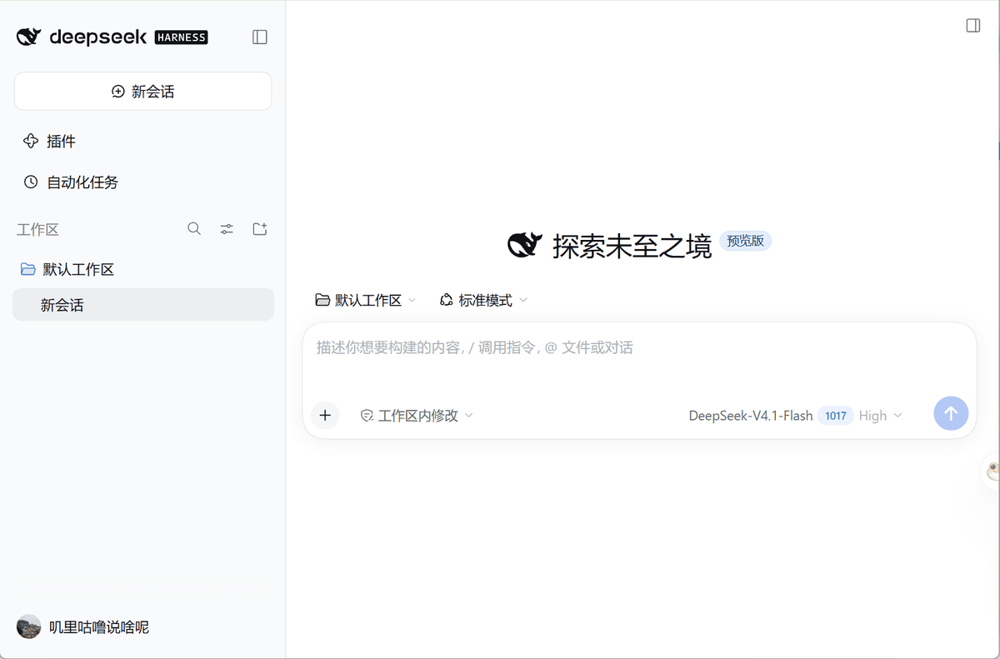

## 第二步：准备一个硅基流动的密钥

插件需要两个“帮手模型”：一个**理解文字**，一个给找回来的记忆**排序**。我选的是硅基流动，两个都免费，而且**一个密钥就够了**（你也可以以后在“高级设置”里换成别家的）。

- 理解文字的模型：硅基流动 `BAAI/bge-m3`
- 排序的模型：硅基流动 `BAAI/bge-reranker-v2-m3`

1. 打开 <https://cloud.siliconflow.cn>，注册 / 登录。

   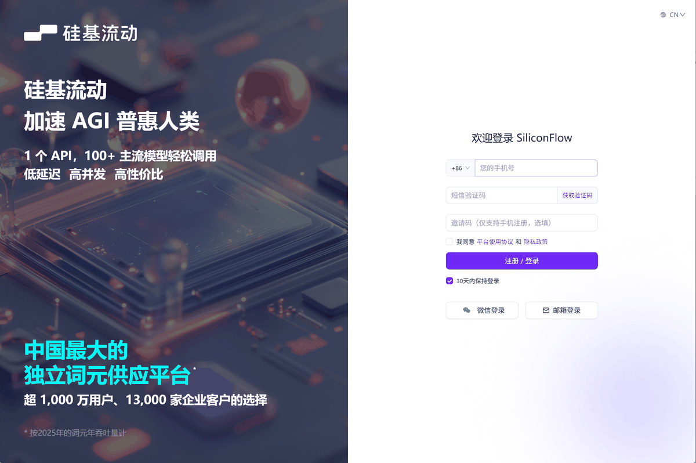

2. 这两个模型都是免费的，不用额外开通：

   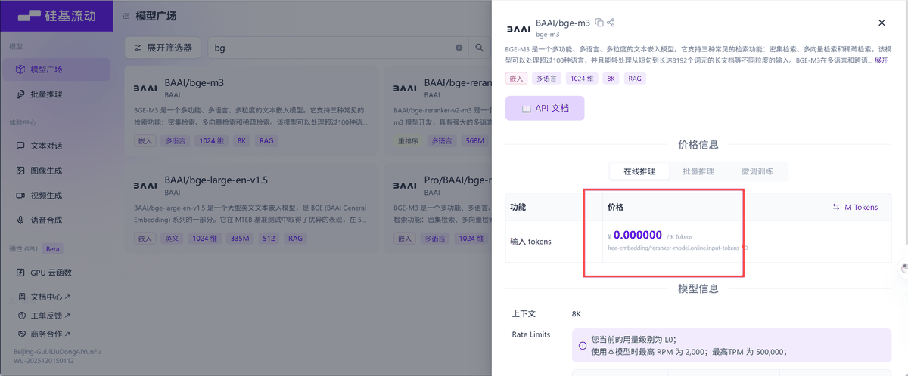
   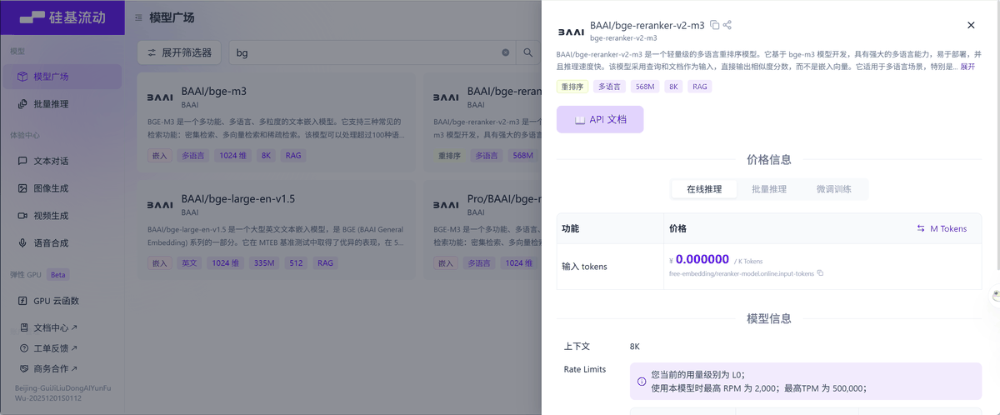

   顺带一提：`XingChenAGI/Xing4.0-29B` 也免费，可以当“整理记忆的模型”备用（插件默认不用它，见后面的说明）。

   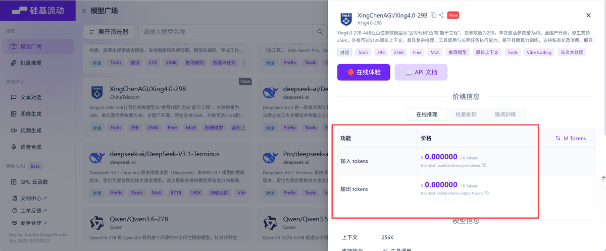

3. 左边点「API 密钥」：

   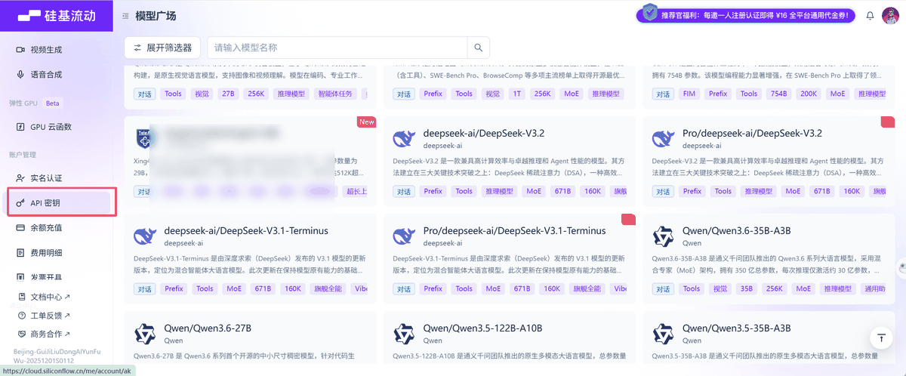

4. 点「新建 API 密钥」，描述随便写，点「新建密钥」：

   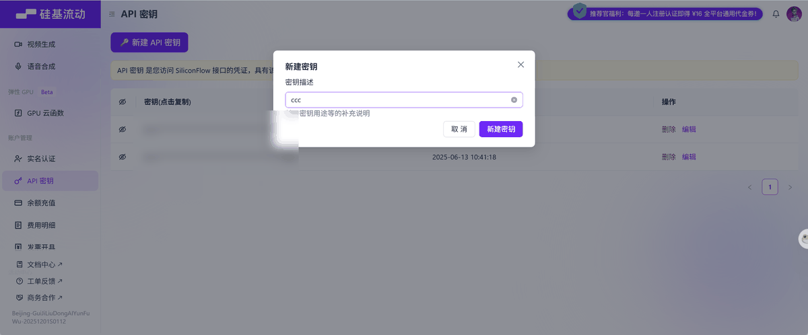
   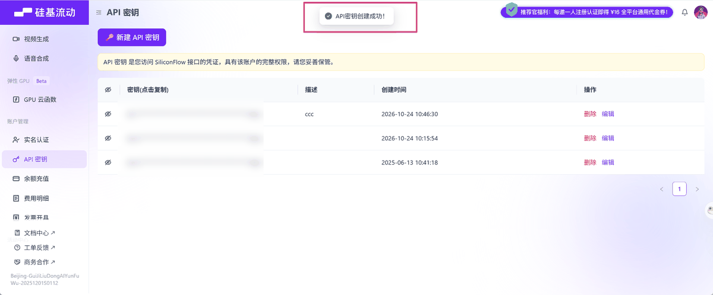

5. 点一下密钥那一栏就复制好了（也许需要先实名认证，我认证过了）。**复制好后先存起来，后面马上要用。**

   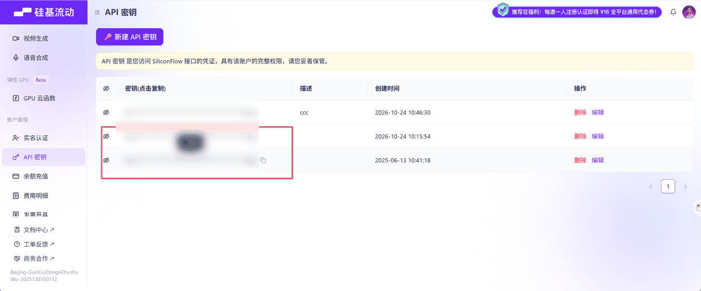

> ⚠️ 密钥就像密码，不要发给别人、不要截图到群里。

## 第三步：安装插件（两种方式选一种）

在 dsh 左边点「Plugins」，再点右上角「+ Add plugin」。

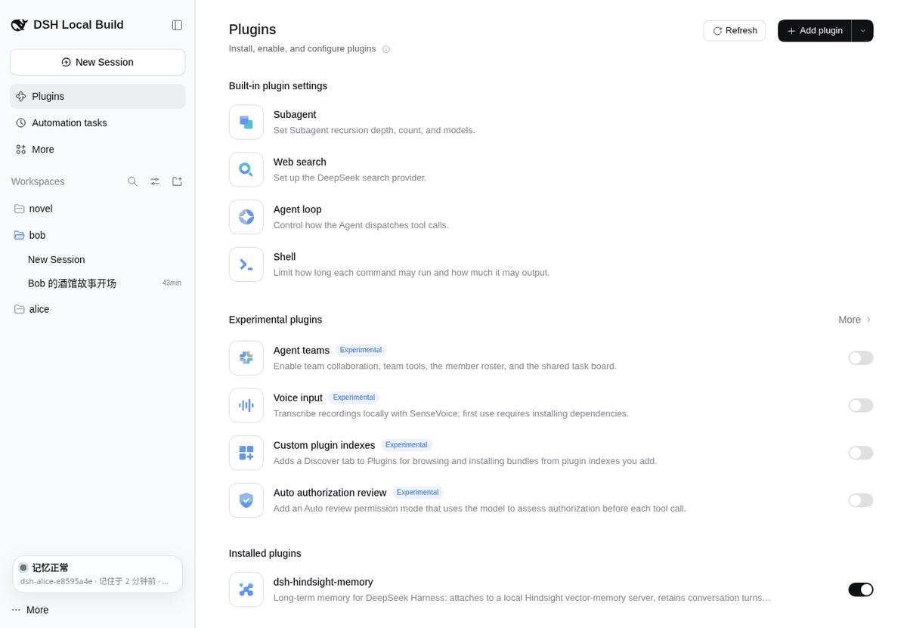

### 方式 A：从 GitHub 安装（推荐，最省事）

在弹出的框里粘贴下面这个地址，点「Install」：

```
https://github.com/snakejohn/dsh-hindsight-local
```

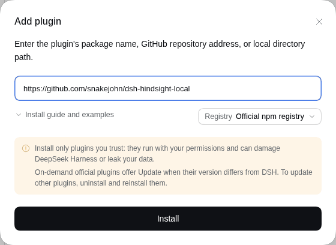

### 方式 B：下载 zip，从本地文件夹安装（网络连不上 GitHub 时用）

1. 打开 <https://github.com/snakejohn/dsh-hindsight-local/releases>，下载最新版本里的 `dsh-hindsight-local-v0.1.0.zip`。
2. 右键 →「全部解压缩」，记住解压出来的文件夹在哪（比如“下载”文件夹里）。
3. 在「Add plugin」框里填这个文件夹的完整路径，点「Install」。

   > 小技巧（Windows）：在资源管理器里打开那个文件夹，点一下顶部地址栏，复制里面的路径就行。

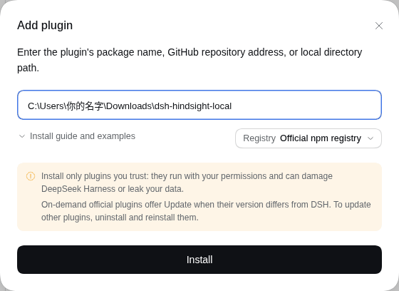

装好后，在「Installed plugins」里能看到 **dsh-hindsight-memory**，确认右边的开关是打开的。

## 第四步：首次设置（真的只有三步）

装好后，左下角会多出一个小卡片，显示 **⚪ 需要设置**，点它就进入设置页。


1. **① 选服务商**：已经帮你选好了“硅基流动”，不用动。
2. **② 粘贴密钥**：把第二步复制的密钥粘进去。等一两秒，它会**自动检查**，出现绿色的「密钥可以用 ✓」就对了。

   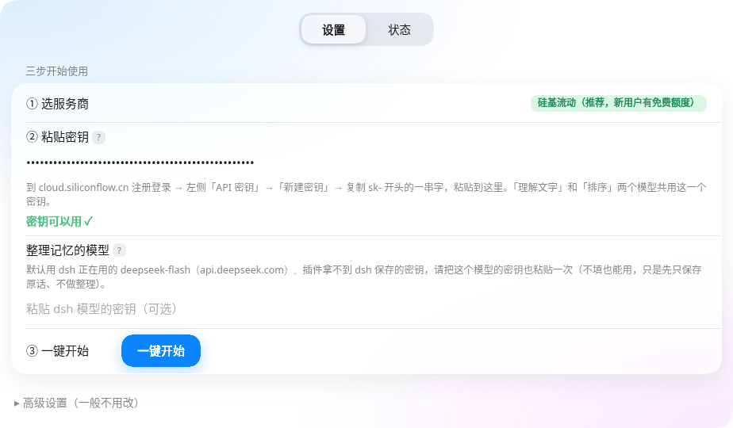

   如果显示“密钥不对”，回硅基流动重新复制一次完整的密钥（`sk-` 开头那一整串，别带空格）。

3. **「整理记忆的模型」**：它负责把聊天内容整理成一条条好找的记忆。默认**和 dsh 用同一个模型**（比如 DeepSeek）。插件拿不到 dsh 自己存的密钥，所以这里可以把那个模型的密钥也粘一次；**不粘也能用**，只是先保存原话、不做整理。
4. **③ 一键开始**：点它。

## 第五步：一键部署（等它自己弄好）

点完「一键开始」，插件会自己完成所有准备：下载运行环境（电脑上没有 Python 也没关系，会自动下载）、下载记忆程序、启动、检查。默认走国内镜像，第一次大约 **3–10 分钟**，之后再开 dsh 只要几秒钟。

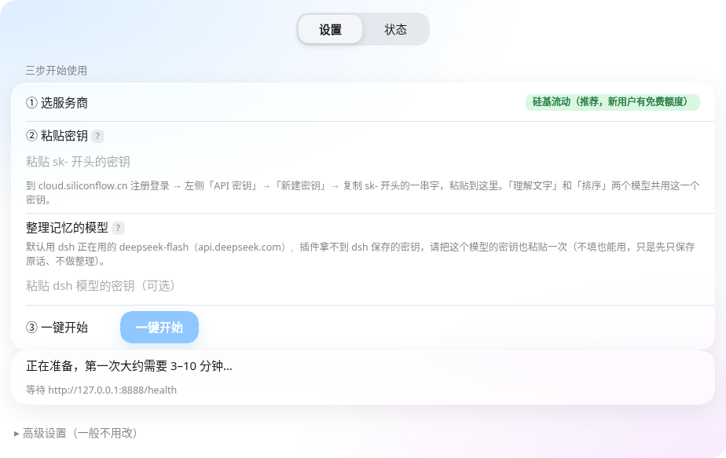

这时左下角是 🟡 **正在准备**：

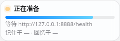

好了以后变成 🟢 **记忆正常**，就大功告成了！以后正常聊天就行，它会自己记、自己想起来。


## 左下角小卡片的意思

| 颜色 | 文字 | 意思 / 你要做什么 |
|---|---|---|
| 🟢 | 记忆正常 | 一切正常，啥也不用管 |
| 🟡 | 正在准备 | 正在下载或启动，等一会儿 |
| 🟡 | 模型被限流 | 模型太忙或额度用完了。会自动重试，要记的内容已排队**不会丢**；也可以去「高级设置」换个模型 |
| ⚪ | 需要设置 | 还没填密钥，点它去设置 |
| 🔴 | 出问题了 | 点它看「发生了什么 + 怎么做」，一般点「重试」就好 |

卡片上还会写：现在用的是哪个**记忆库**、有几条**等着记住**、**上次记住**和**上次回忆**是什么时候。鼠标放上去能看到完整信息。

## 状态页

点左下角卡片，或在插件页面点上面的「状态」，就能看到：记忆服务是不是正常、准备进度每一步、用了多少内存，以及三个按钮：

- **检查一下**：看看服务通不通。
- **重新启动**：卡住了就点它。
- **重新安装**：反复出错时点它，会重新下载记忆程序。

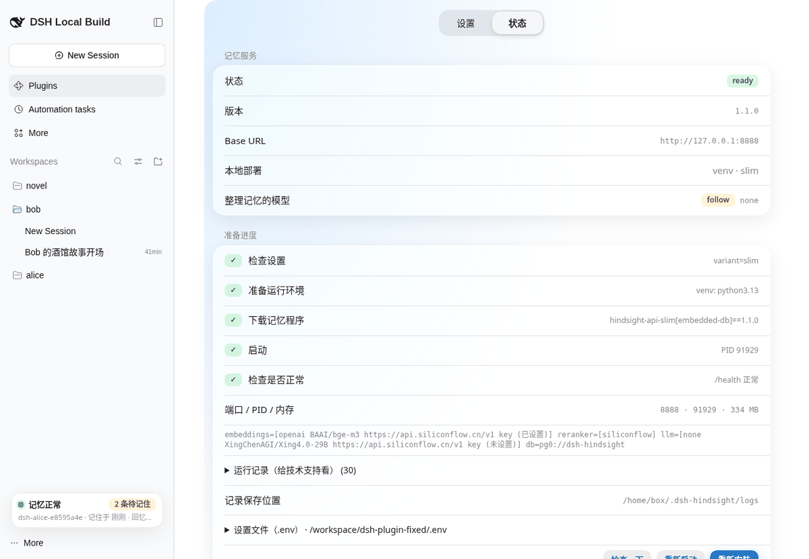

往下拉还有“看看记住了什么”、“最近记住的”、“没记住的”等。

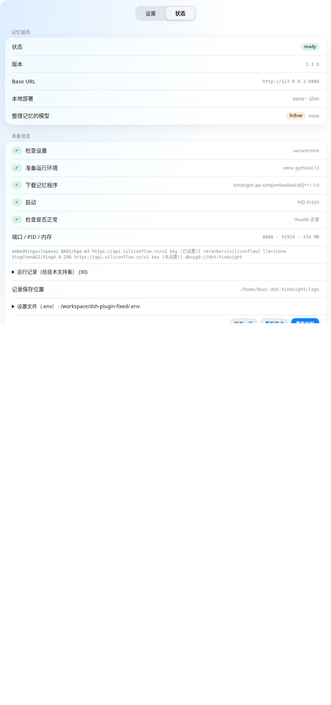

## 主动记忆（让它现在就记住）

平时它会自动记。如果你想让它**马上**把以前的对话也记住：「设置」→「高级设置」→「现在就记住」：

- **记住这个工作区的对话**：只记你选中的那个工作区。
- **记住全部对话（不含已归档）**：所有没归档的对话都记一遍。

已经记过的内容不会重复记；**归档了的对话不会被记住**。

## 高级设置：换模型、换服务商

一般不用动。需要时点「高级设置（一般不用改）」展开：

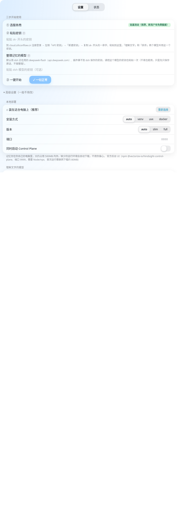

- **理解文字的模型 / 排序模型 / 整理记忆的模型**：三个都可以各自换服务商和模型。选好服务商，地址会**自动填好**；填上密钥后点「获取模型」，能直接从列表里挑。
- 排序模型和整理记忆的模型如果跟“理解文字的模型”是同一家，**密钥留空就会自动共用**。
- 整理记忆的模型有三个选择：**和 dsh 用同一个**（默认）/ **自己指定**（比如选硅基流动的 `XingChenAGI/Xing4.0-29B`）/ **不整理**。
- **记忆库**：默认每个工作区各记各的；也可以让所有工作区共用一个。工作区列表会自动读出来，并显示每个工作区有几个对话（不算已归档的）。

改完记得点底部的「保存」。

深色模式下也一样好看：

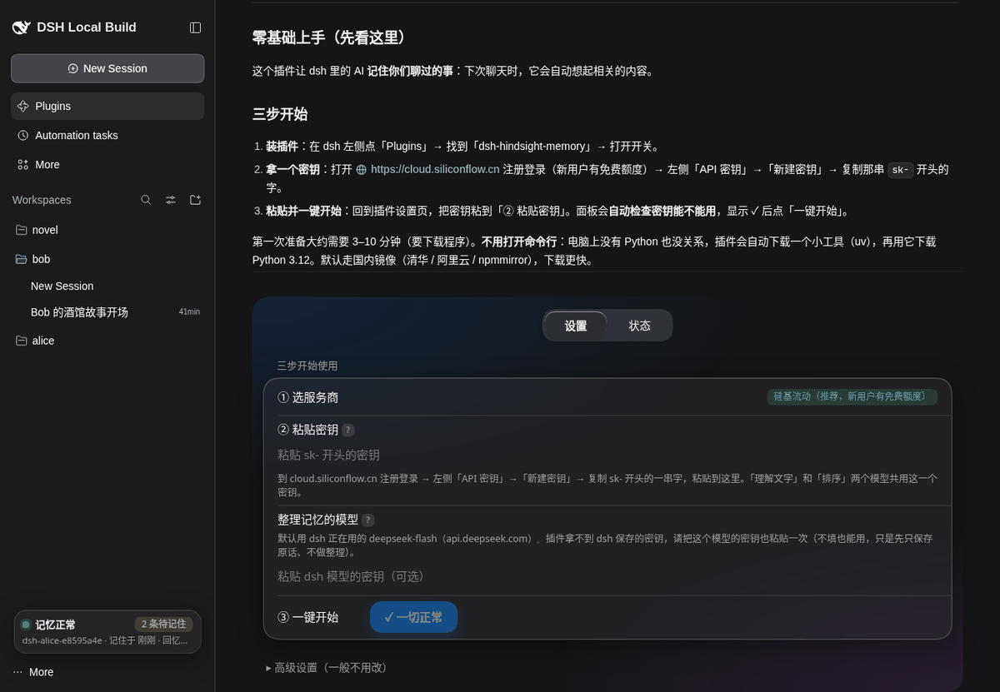

## 常见问题

**Q：要花钱吗？**
A：插件免费。默认用的两个硅基流动模型也免费；“整理记忆的模型”默认用 dsh 的那个，按你那边的计费。

**Q：一直显示“正在准备”？**
A：第一次要下载几百 MB，网速慢会久一点。超过 20 分钟，去「状态」页点「重新安装」。

**Q：显示“出问题了：端口被占用”？**
A：有别的程序占了 8888 端口。重启电脑后再试，或在「高级设置 → 端口」换一个数字（比如 8899），保存。

**Q：显示“下载失败 / 网络问题”？**
A：检查能不能上网；开了代理或 VPN 的话先关掉再点「重试」。插件默认用国内镜像。

**Q：显示“密钥不对”？**
A：回硅基流动重新复制完整的密钥，粘贴后等出现「密钥可以用 ✓」。

**Q：显示“模型被限流”？**
A：模型太忙或免费额度用完了。插件会自己隔一会儿重试，要记的内容不会丢。急的话去「高级设置」换一个模型。

**Q：我的聊天会被传到哪里？**
A：记忆存在**你自己电脑上**。为了理解和整理文字，聊天内容会发给你选的模型服务商（默认硅基流动和 dsh 的模型）。

**Q：我的密钥存在哪？安全吗？**
A：存在插件文件夹里的 `.env` 文件和 dsh 的设置里，只在你自己的电脑上；日志里不会出现密钥。别把这个文件发给别人。

**Q：出问题想找人帮忙，要发什么？**
A：把这个文件夹里的 `hindsight.log` 和 `install.log` 发过去：
Windows：`C:\Users\你的用户名\.dsh-hindsight\logs\`
Mac / Linux：`~/.dsh-hindsight/logs/`

**Q：Windows / Mac 能用吗？**
A：能装，但作者目前只在 Linux 上完整测试过，Windows / Mac 还没有真机验证。遇到问题欢迎到 GitHub 提 issue：<https://github.com/snakejohn/dsh-hindsight-local/issues>
